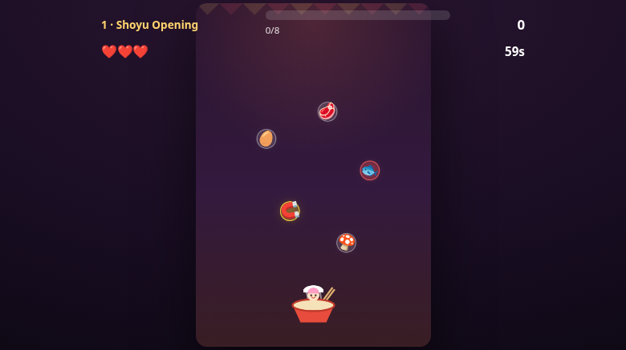

# 🍜⚡ Rin's Ramen Rush

A fast arcade game about catching noodles, dodging fish, and serving a perfect bowl.

> **▶️ Play it live:** [rinlives.github.io/ramen-rush](https://rinlives.github.io/ramen-rush/)

## How to play
- Steer the bowl with **← →**, **A / D**, your mouse, or your finger.
- 🥚 🥩 🎍 🍄 🌸 **Catch** the good ingredients to fill your bowl.
- 🐟 🪨 🕸️ **Dodge** the bad stuff — it costs a life.
- 🧲 ⏳ 🛡️ ✨ 🌊 Grab **power-ups**: Magnet, Slow-Mo, Shield, 2× Score, Big Broth.
- Fill the **bowl meter** before the clock hits zero. **5 levels**, each faster and meaner.
- Clear all five → **PERFECT RAMEN!** 🎉

## Features
- 5 hand-tuned levels with rising fall speed, spawn rate, and hazard density
- 5 timed power-ups plus a stackable shield
- Combo-streak scoring with level + combo bonuses
- High score saved locally in your browser
- Sound effects (Web Audio), particle bursts, screen shake, and a confetti win screen
- Fully responsive — keyboard, mouse, and touch
- **One file**, no build, no dependencies, works offline

## Tech
A single `index.html` — HTML + CSS + vanilla JavaScript on a `<canvas>`. No frameworks,
no build step. Steal it, fork it, remix it.

## Files
- `index.html` — the whole game
- `screenshot.png` — a peek inside
- `LICENSE` — MIT

---
Made by [rinlives](https://github.com/rinlives) · powered by an imaginary bowl and zero real soup 🍜
